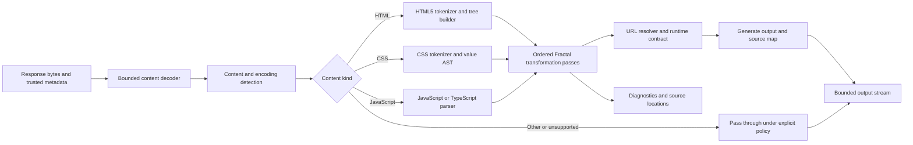

# Fractal Rewriter Design

**Status: DESIGN ONLY.** The current `@refractjs/refract-rewriter` only resolves URLs. No HTML, CSS, or JavaScript transformation described here is implemented. The design is independent; it does not depend on or adapt Scramjet transformations.

## Design Goals

- Preserve standards-defined document and module behavior for an explicitly tested subset.
- Separate parsing from Fractal policy and transformation logic.
- Keep source positions and produce diagnostics for every skipped or changed construct.
- Make output deterministic for the same input, base URL, policy, and engine version.
- Avoid changing author-observable values unless runtime virtualization requires it and a test defines the behavior.
- Fail closed for security-sensitive transformations; do not silently emit partially transformed active content.
- Keep the parser/runtime contract transport-neutral and testable without a browser.

## Current Boundary

`@refractjs/refract-rewriter` exports `RefractRewriter.resolveUrl()`. It resolves absolute/relative HTTP(S) URLs and preserves a small set of non-network schemes. Fractal Core calls this URL resolver before dispatch. Shared response bodies are currently `string | Uint8Array`; there is no content-type detection, HTML/CSS/JS parser, streaming rewriter, proxy URL encoder, source-map pipeline, or browser runtime. All feature flags default to disabled.

The current packages are independent of Scramjet packages. This independence must remain a package and source boundary; parser reuse is allowed, but Scramjet transformation code, internal APIs, and output formats are not a foundation for Fractal.

## Proposed Pipeline



Parsing must be content-type-aware, not inferred from a URL suffix alone. `Content-Encoding`, charset, BOM, MIME sniffing rules, and invalid input are explicit inputs. Keep original bytes if decoding or parsing fails; whether pass-through is allowed depends on content type, site-isolation policy, and whether unrewritten active content could escape Fractal. Active documents must not silently pass through as though they were safely proxied.

## Proposed Package and Interfaces

Keep the existing package names during this milestone. Keep parser dependencies and transformation passes in `@refractjs/refract-rewriter`; it may depend on `refract-shared` for errors and request metadata, but not on the example app, controller, transport implementation, or legacy packages.

```ts
export type RefractContentKind = "html" | "css" | "javascript" | "unknown";

export interface RewriterInput {
  body: Uint8Array;
  contentType: string | undefined;
  contentEncoding: string | undefined;
  responseUrl: string;
  requestDestination: string | undefined;
  moduleType: "classic" | "module" | undefined;
  documentContext: RewriterDocumentContext;
  policy: RewriterPolicy;
  signal?: AbortSignal;
}

export interface RewriterOutput {
  body: Uint8Array;
  contentType: string;
  sourceMap?: Uint8Array;
  diagnostics: RewriterDiagnostic[];
  changed: boolean;
}

export interface ContentRewriter {
  readonly kind: RefractContentKind;
  supports(input: RewriterInput): boolean;
  rewrite(input: RewriterInput): Promise<RewriterOutput>;
}
```

This is a proposal, not a current public API. The first implementation should be buffered and bounded because Core currently buffers responses. Introduce a stream interface only after incremental parser behavior, error semantics, cancellation, and backpressure are tested. Do not promise that arbitrary browser-generated code can be intercepted from response rewriting alone.

### Context and URL contract

Every pass receives an immutable context containing the original response URL, effective document base URL, top-level and frame identities, destination kind, module status, referrer policy, and a versioned URL policy. A central URL service returns a structured result (rewritten URL, untouched non-network URL, or error) instead of letting each pass invent its own mapping. Preserve fragments and distinguish navigation URLs from resource URLs.

Generated requests must be distinguishable from original requests without trusting a client-supplied identity. The future gateway owns request authentication, destination policy, redirects, cookies, and cache partition identity; the rewriter must not be a security boundary by itself.

## HTML Plan

Use a conforming HTML5 parser/tree builder with source locations. Parsing is not equivalent to a regex scan: raw-text elements, malformed markup recovery, namespaces, templates, and insertion modes affect the tree. Prefer minimal attribute/source edits where an implementation can preserve exact untouched markup; otherwise document serialization differences and test them.

| Surface           | Proposed behavior                                                                                                                                                                                                            | Required cases                                                                                          |
| ----------------- | ---------------------------------------------------------------------------------------------------------------------------------------------------------------------------------------------------------------------------- | ------------------------------------------------------------------------------------------------------- |
| Links/navigation  | Rewrite eligible `a[href]`, area, history, and location destinations through a typed navigation policy. Preserve fragments, targets, download semantics, and author-visible values through runtime accessors where required. | Relative, absolute, protocol-relative, fragment-only, custom scheme, target names, redirects, popstate. |
| Forms             | Rewrite form/action and submitter `formaction`; preserve method, encoding, target, validation, submit events, and user activation.                                                                                           | GET/POST, submit buttons, `requestSubmit`, `form.submit`, multipart, `target`, invalid form.            |
| Scripts           | Rewrite external script sources and inline script contents using the JS pass. Preserve module/classic type, async/defer, ordering, nonce/integrity policy, and parser-blocking behavior.                                     | Inline/external, dynamic insertion, `document.write`, module scripts, import maps, SRI/CSP.             |
| Styles            | Rewrite stylesheet links, `<style>`, style attributes, CSSOM entry points, and adopted/constructed stylesheets only where runtime interception exists.                                                                       | Inline, external, CSSOM writes, constructable sheets, nested `@import`.                                 |
| Images/media      | Rewrite `src`, `srcset`, poster, source, SVG href, preload and other typed URL attributes.                                                                                                                                   | `picture`, density/width descriptors, data/blob URLs, audio/video, SVG, lazy loading.                   |
| Base URL          | Track `<base href>` in document order and apply it to subsequent URL resolution; retain the original base semantics as exposed to page code.                                                                                 | Multiple base elements, mutation after parse, malformed base, `document.baseURI`.                       |
| Meta refresh      | Parse the content directive with a state machine and route navigation under the same policy.                                                                                                                                 | Whitespace, quoted URLs, delay, malformed directives.                                                   |
| Dynamic resources | Static HTML transformation cannot see later DOM changes. A future browser runtime must intercept the relevant DOM setters and script/resource creation APIs.                                                                 | `setAttribute`, properties, `innerHTML`, `insertAdjacentHTML`, CSSOM, DOM parser APIs.                  |

Never silently strip CSP, `integrity`, sandbox attributes, or origin isolation headers as a generic compatibility shortcut. CSP/SRI need a separately reviewed translation model; if bytes change, original SRI hashes no longer validate. Until translation exists, report the limitation and keep the supported local fixture's restrictive CSP.

## CSS Plan

Parse CSS tokens/values and identify URLs in grammar context. Do not transform substrings inside comments, strings, custom-property token streams, or unrelated identifiers. Preserve escape decoding/serialization and source locations. CSS modules and nesting are parser/versioned capabilities, not regex extensions.

| Construct                | Proposed pass                                                                                                                                                      |
| ------------------------ | ------------------------------------------------------------------------------------------------------------------------------------------------------------------ |
| `url()`                  | Transform URL tokens after CSS escape processing; retain quoting or generate a correctly escaped equivalent.                                                       |
| `@import`                | Transform the import URL and preserve media/supports/layer qualifiers. Resolve nested imports from each imported stylesheet URL.                                   |
| Fonts/images/backgrounds | Use the same typed URL service for `@font-face`, image-set, backgrounds, cursors, masks, and list-valued declarations.                                             |
| Comments and strings     | Leave untouched unless a parser proves the token is a URL-bearing CSS value.                                                                                       |
| Dynamic CSS              | Static response transform does not cover `CSSStyleDeclaration`, CSSOM methods, constructable stylesheets, or generated styles; these require runtime interception. |

Candidate approaches: PostCSS is already present transitively in the lockfile and offers a mature plugin AST, but its parser is error-recovering and source formatting/generation behavior needs benchmarking. CSSTree is a CSS syntax AST/lexer candidate but is not currently a direct workspace dependency. Lightning CSS is a Rust parser/transformer candidate with different integration and output tradeoffs. Select none until a fixture corpus, current maintenance/license review, source-map needs, output fidelity, bundle size, and throughput are measured. Reusing an existing parser does not imply reusing another proxy's transformations.

## JavaScript and TypeScript Plan

Transform parsed AST nodes, never source text with a regex. Keep passes small, ordered, idempotent where possible, and attached to parser source spans. A transform must distinguish identifier references from property names, strings, comments, shadowed locals, and generated code.

| Construct                        | Proposed treatment                                                                                                                                       | Compatibility bound                                                                                              |
| -------------------------------- | -------------------------------------------------------------------------------------------------------------------------------------------------------- | ---------------------------------------------------------------------------------------------------------------- |
| Static imports/exports           | Rewrite source specifiers after module-map resolution.                                                                                                   | Bare specifiers require import-map support or an explicit unsupported diagnostic.                                |
| Dynamic `import()`               | Transform literal specifiers; delegate nonliteral expressions to a runtime resolver only when the runtime contract can preserve Promise/error semantics. | Arbitrary computed strings cannot be resolved statically.                                                        |
| `import.meta.url`                | Provide the effective remote module URL in module scope and preserve `resolve` semantics where supported.                                                | Script context and inline modules differ; test per browser.                                                      |
| `fetch`/XHR                      | Route requests through a browser runtime/client gateway. AST call rewriting alone misses aliases, bound references, indirect calls, and other realms.    | Runtime mediation is required; any missed call is an explicit limitation.                                        |
| WebSocket                        | Rewrite URL and use an authorized transport/runtime adapter.                                                                                             | WebSocket constructor cannot accept arbitrary browser request headers; protocol/auth constraints remain.         |
| Worker/SharedWorker              | Rewrite constructor URL and preserve worker kind/options; bootstrap worker runtime before author code.                                                   | Module graphs, MIME, origin identity, nested workers, Blob workers, CSP are separate cases.                      |
| ServiceWorker                    | Do not blindly rewrite registration. Define scope, script identity, update, and lifecycle policy in the browser runtime.                                 | Browser origin/scope/security rules apply; unsupported registration must fail visibly.                           |
| Dynamic scripts/URL constructors | Browser runtime intercepts resource-creating DOM/API operations; AST transforms cover statically visible constructors only.                              | Reflection, aliases, `eval`, `Function`, WebAssembly and realm escape make complete static mediation impossible. |
| `eval`/`Function`                | Start unsupported. Add only a narrowly tested transform if parsing, source identity, CSP, and error semantics are well-defined.                          | Dynamic code may be generated or obfuscated; no claim of complete mediation.                                     |

### Parser/library evaluation

| Candidate                             | Strengths                                                                                                | Tradeoffs to measure                                                                                                                                                                                                           |
| ------------------------------------- | -------------------------------------------------------------------------------------------------------- | ------------------------------------------------------------------------------------------------------------------------------------------------------------------------------------------------------------------------------ |
| TypeScript compiler API               | Parses TypeScript, JSX/TSX, and JavaScript; detailed syntax tree; already a root development dependency. | Large runtime footprint, TypeScript-specific AST, printer may reformat output, and TS syntax is not executable browser JS without transpilation.                                                                               |
| Acorn + plugins                       | Small ESTree parser; Acorn versions are already present transitively in the lockfile.                    | TypeScript support needs a separate plugin/parser; proposal plugins and AST compatibility must be versioned.                                                                                                                   |
| Babel parser                          | Broad JavaScript/TypeScript/JSX syntax and plugin ecosystem.                                             | Larger dependency/runtime footprint; parser/generator output and plugin option matrix need control.                                                                                                                            |
| Oxc Rust crates / optional WASM build | High-performance parser candidate; Oxc 0.95.0 is in the legacy Rust rewriter's Cargo workspace.          | Existing use is legacy-only. Fractal may independently evaluate Oxc as a parser, but must not import its legacy transform/runtime; Wasm build size, ABI, memory ownership, supported syntax, and maintenance must be measured. |
| SWC Rust crates / Wasm                | Rust AST and TS/JSX parsing ecosystem.                                                                   | Separate Rust toolchain/dependency graph; AST/codegen compatibility and browser bundle size need evaluation.                                                                                                                   |

No parser was selected or added in this milestone. A parser POC must consume the adversarial fixtures from the existing Runway corpus as inputs, but Fractal tests must independently assert its own semantics; expected Scramjet behavior is not a golden implementation.

## Module Graph and Workers

Represent a module as `(effective URL, module type, import-map snapshot, credentials mode, policy version)`. Resolve each edge relative to the importing module, apply the active import-map scope algorithm, and retain a graph edge with original source span. Cache parse artifacts by content hash plus parser version; cache transformed output by content hash plus effective URL, policy, import map, and transform versions. Never cache user-specific credential state under a shared key.

Detect cycles using the browser's module-map identity model, not recursive text replacement. Preserve failure propagation and specifier error locations. `import.meta.url` must refer to the effective remote module, not an app/proxy URL. Workers have a separate global and base URL; dedicated/shared/module workers need explicit bootstrap and lifetime policies. Service workers are a separate security boundary and are not ordinary workers.

## Diagnostics, Source Maps, and Failure Policy

Each diagnostic includes stable code, severity, source URL with credentials stripped, source range, transformation pass, and whether output changed. Never include request cookies, authorization headers, full sensitive query strings, or source bodies in production diagnostics. Source maps must map generated ranges back to the original source and preserve `sourcesContent` only under an explicit privacy policy.

Failure policy by content type:

- Unknown or non-active binary content: pass through unchanged under the gateway's normal policy.
- CSS: only pass through unchanged if the calling policy explicitly permits unrewritten style resources; otherwise return a typed unsupported error.
- HTML/JavaScript documents or modules: do not claim proxy safety if transformation failed. Fail the navigation/resource clearly rather than delivering unmediated active code.
- Cancellation, size limits, decoding errors, parse errors, and unsupported syntax have distinct error codes and never produce success diagnostics.

## Security Considerations

- The rewriter is not an SSRF boundary. URL resolution must feed a separately authenticated, DNS-pinned gateway.
- Remote HTML/JS is hostile. A frame's CSP, sandbox, origin isolation, navigation policy, and cookie/storage partition are runtime responsibilities.
- Rewrites can weaken CSP/SRI or permit a direct network escape. Every changed policy must be explicit, reviewed, and browser-tested.
- Normalize and validate URL encodings once. Prevent parser differential/ambiguous URL interpretation between rewriter, browser, gateway, and transport.
- Bound input bytes, parser depth, node count, token count, AST nodes, time, output bytes, graph breadth, and memory per navigation.
- Avoid cross-tenant reuse of transformed bytes when output depends on tenant, cookies, or runtime configuration.
- Malformed HTML/CSS/JS must not trigger unbounded recursion or partial unsafe transformation.

## Compatibility Matrix

This matrix describes the current Fractal implementation, not target support. Every row is **NOT IMPLEMENTED** for Fractal rewriting unless a later, dated test report changes it.

| Feature                                                | Fractal status  | First acceptance evidence                                                                                       |
| ------------------------------------------------------ | --------------- | --------------------------------------------------------------------------------------------------------------- |
| HTML parsing, URL attributes, forms, base/meta refresh | NOT IMPLEMENTED | Unit corpus plus browser fixture proving resulting request route and author-visible DOM values.                 |
| Inline/external scripts and inline styles              | NOT IMPLEMENTED | Browser tests for execution/order and CSS rendering under the documented sandbox/CSP.                           |
| CSS `url()`, `@import`, fonts, escapes/comments        | NOT IMPLEMENTED | Parser fixtures and browser CSSOM/computed-style checks.                                                        |
| JavaScript static imports/exports                      | NOT IMPLEMENTED | Browser module graph test including relative and bare specifiers.                                               |
| Dynamic import and import-map scopes                   | NOT IMPLEMENTED | Browser tests for static/dynamic scope resolution, cycles, errors, and identity.                                |
| `import.meta.url` and source maps                      | NOT IMPLEMENTED | Module URL semantics and source-map location assertions in a real browser.                                      |
| Fetch/XHR and dynamic resource creation                | NOT IMPLEMENTED | Runtime interception tests that prove no direct destination request bypasses Fractal.                           |
| Dedicated/shared/module workers                        | NOT IMPLEMENTED | Worker execution, import graph, origin, cancellation, and lifecycle browser tests.                              |
| ServiceWorker registration                             | NOT IMPLEMENTED | Separate origin/scope/security design and browser conformance suite; do not infer from ordinary Worker support. |
| Blob/data/WebAssembly resources                        | NOT IMPLEMENTED | MIME, streaming, lifetime, and browser behavior tests per API.                                                  |
| CSP/SRI translation                                    | NOT IMPLEMENTED | Security review and tests showing policy/integrity remains enforced or a documented fail-closed result.         |

## Test and Benchmark Plan

1. Unit tests for content-type/encoding detection, URL mapping, each AST/token pass, source spans, diagnostics, idempotency, and unchanged inputs.
2. Corpus tests for malformed and large inputs; modern syntax, TS/JSX, comments/escapes, CSS URLs/imports, module cycles, import maps, workers, CSP/SRI and dynamic DOM cases.
3. Browser fixture tests for DOM-visible URL semantics, scripts, CSSOM, navigation, history, modules/workers, errors, and no direct network escape.
4. Differential tests compare specified browser behavior and standards vectors, not copied Scramjet output. Record browser versions and known limitations.
5. Benchmarks by content class/size: parse-only, transform-only, generation, end-to-end response processing, bytes, p50/p95, CPU, peak RSS, allocations, and time to first emitted chunk.
6. Streaming experiments compare bounded buffering and incremental HTML tokenization; do not stream active script output until output ordering and parser-insertion semantics are established.

## Incremental Implementation Roadmap

1. **R0: contract and fixtures.** Freeze `RewriterInput`/diagnostic semantics, URL policy, content detection, and the fixture corpus. No transformations yet.
2. **R1: HTML static resources.** HTML5 parse and rewrite a small URL-attribute subset; no scripts are enabled in the browser until runtime security exists.
3. **R2: CSS resources.** Token/AST URL and import rewriting with source locations and CSSOM follow-up boundary documented.
4. **R3: JS module source.** Parser POC and static import/export rewriting with import maps and module identity tests.
5. **R4: runtime-dependent transforms.** Integrate only after the browser controller, sandbox/CSP model, and request interception API are specified.
6. **R5: streaming/performance.** Profile complete navigation and optimize only bottlenecks supported by measurements.

Every stage must keep unsupported features explicit and rerun `pnpm refract`, `pnpm example:test`, and the relevant browser fixture suite. This roadmap is not evidence that any stage has shipped.

## References for Evaluation

These are candidates and normative sources, not selected dependencies or adopted implementation behavior:

- [parse5](https://github.com/inikulin/parse5) and the [HTML parsing algorithm](https://html.spec.whatwg.org/multipage/parsing.html).
- [htmlparser2](https://github.com/fb55/htmlparser2) (already used by the retained legacy tree) is a useful performance/DOM API comparison, not a Fractal dependency decision.
- [PostCSS](https://postcss.org/), [CSSTree](https://github.com/csstree/csstree), [Lightning CSS](https://lightningcss.dev/), and [CSS Syntax Level 3](https://www.w3.org/TR/css-syntax-3/).
- [Acorn](https://github.com/acornjs/acorn), [Babel parser](https://babeljs.io/docs/babel-parser), [TypeScript Compiler API](https://github.com/microsoft/TypeScript/wiki/Using-the-Compiler-API), [Oxc parser](https://oxc.rs/docs/guide/usage/parser.html), and [SWC](https://swc.rs/docs/usage/core).
- [HTML import maps](https://html.spec.whatwg.org/multipage/webappapis.html#import-maps), [ECMAScript modules](https://tc39.es/ecma262/#sec-modules), [Source Map standard](https://tc39.es/source-map/), [CSP Level 3](https://www.w3.org/TR/CSP3/), and [Subresource Integrity](https://www.w3.org/TR/SRI/).

The current pnpm lockfile includes TypeScript 5.9.3, Acorn 8.15/8.16 transitively, PostCSS 8.5.6 transitively, and legacy `htmlparser2` 12.0.0. Oxc 0.95.0 is in the legacy Rust rewriter's Cargo workspace only. These facts do not choose a Fractal parser or authorize importing legacy transformation logic. No parser dependency was added for this design milestone.
