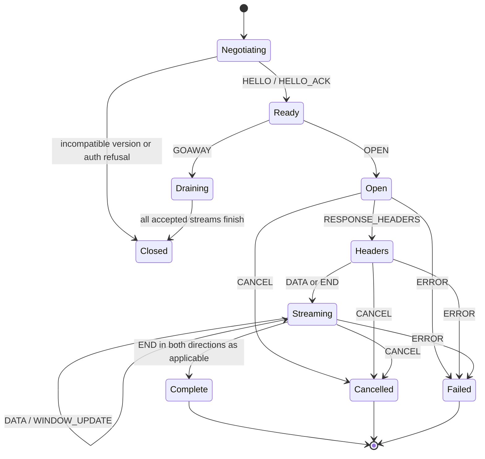
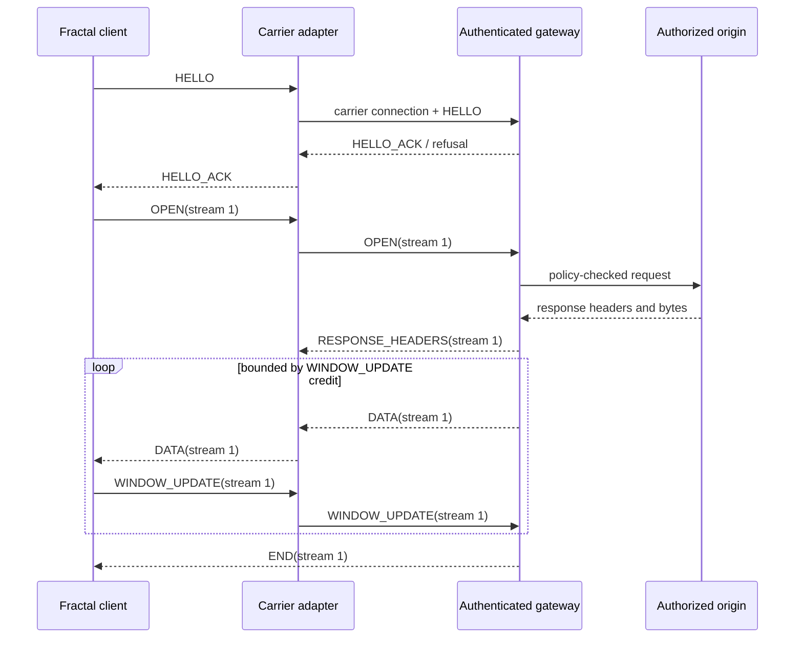

# PRISM Protocol Specification

**Status: DESIGN ONLY / proposed version 0.1.** PRISM is not implemented, has no adapter, and is not in Fractal Core's request path. This proposal is an independent message contract, not a rename or reproduction of Wisp, Bare, HTTP, WebSocket, or another proxy protocol. It requires review before implementation.

## Goals and Non-Goals

PRISM provides a bounded, multiplexable request/response stream contract between an authenticated Fractal client and a trusted Fractal gateway. It defines framing, correlation, streaming, flow control, errors, negotiation, and adapter capabilities. It does not define HTTP semantics, destination authorization policy, DNS behavior, cookies, or an encryption algorithm; those are owned by the gateway and carrier security.

V0.1 prioritizes unambiguous bounded frames, one owner per stream, cancellation, explicit end/error, and carrier-independent tests. It does not promise that all carriers support the same duplex, multiplexing, datagram, or backpressure features.

## Frame Encoding

All multibyte integers are unsigned big-endian. A frame has a fixed 20-byte header followed by exactly `payload_length` bytes:

| Offset | Width | Field          | V0.1 rule                                                         |
| -----: | ----: | -------------- | ----------------------------------------------------------------- |
|      0 |     4 | Magic          | ASCII `PRSM` (`0x50 0x52 0x53 0x4d`)                              |
|      4 |     1 | Major          | `0x01`                                                            |
|      5 |     1 | Minor          | `0x00` for this draft                                             |
|      6 |     1 | Type           | Message type below                                                |
|      7 |     1 | Flags          | Defined per message; unknown bits are a protocol error            |
|      8 |     4 | Stream ID      | `0` for connection control; nonzero for a request stream          |
|     12 |     4 | Sequence       | Monotonically increasing per stream and direction, beginning at 0 |
|     16 |     4 | Payload length | Byte count excluding header; checked before allocation/read       |

Frame boundaries are independent of carrier packet/frame boundaries. Receivers must tolerate partial header/payload reads and multiple complete frames in one carrier read. V0.1 has no compression or padding. Unknown frame types are fatal to that connection version. Reserved flag bits must be zero.

Default limits for a reference implementation: 64 KiB connection-control payload; 64 KiB OPEN/response-header payload; 1 MiB DATA payload; 16 MiB initial per-stream receive window; 64 MiB total connection window; 128 simultaneous streams per connection. Negotiated limits may lower these ceilings, never exceed implementation hard limits. These are starting limits to benchmark, not throughput claims.

## Message Types

|   Type | Name               | Direction       | Stream                  | Payload                                        |
| -----: | ------------------ | --------------- | ----------------------- | ---------------------------------------------- |
| `0x01` | HELLO              | Client → server | 0                       | JSON negotiation offer                         |
| `0x02` | HELLO_ACK          | Server → client | 0                       | JSON selected version/capabilities or refusal  |
| `0x03` | PING / `0x04` PONG | Either          | 0                       | 8 opaque bytes echoed                          |
| `0x05` | GOAWAY             | Either          | 0                       | JSON reason and last accepted client stream ID |
| `0x10` | OPEN               | Client → server | client-initiated stream | JSON request metadata                          |
| `0x11` | RESPONSE_HEADERS   | Server → client | same stream             | JSON status and response headers               |
| `0x12` | DATA               | Either          | same stream             | Raw body bytes                                 |
| `0x13` | END                | Either          | same stream             | JSON final byte counts and optional trailers   |
| `0x14` | CANCEL             | Either          | same stream             | JSON stable cancellation code/reason           |
| `0x15` | ERROR              | Either          | same stream or 0        | JSON stable error                              |
| `0x16` | WINDOW_UPDATE      | Either          | 0 or stream             | 4-byte positive credit increment               |

No cookie, bearer token, authorization header, or secret may be copied into diagnostic metadata. Header allowlists, credential forwarding, destination authorization, and tenant identity are server policy. A carrier must authenticate the client before OPEN is accepted; connection authentication does not authorize destinations.

### JSON payloads

JSON payloads are UTF-8 objects with duplicate keys rejected, maximum nesting depth 16, maximum 256 headers, maximum string length 16 KiB, and total payload bounded by the frame-specific cap. Header names are lowercased ASCII tokens; values reject CR/LF and invalid control characters. Values that carry secrets are permitted only in the authenticated request data plane under server policy and are never logged by PRISM.

Example HELLO:

```json
{
  "versions": [{ "major": 1, "minor": 0 }],
  "client": { "name": "fractal-browser", "version": "0.1.0" },
  "limits": { "maxFrameBytes": 1048576, "maxStreams": 64 },
  "capabilities": ["duplex-stream", "cancel", "flow-control"]
}
```

Example OPEN (sensitive headers omitted):

```json
{
  "method": "GET",
  "url": "https://fixture.invalid/resource",
  "destination": "document",
  "headers": [["accept", "text/html"]],
  "timeoutMs": 4000,
  "requestId": "opaque-correlation-id"
}
```

Example RESPONSE_HEADERS:

```json
{
  "status": 200,
  "statusText": "OK",
  "headers": [["content-type", "text/html; charset=utf-8"]]
}
```

The URL is untrusted input. The gateway applies authentication, scheme/host policy, DNS/IP validation, per-hop redirect checks, quotas, and audit redaction before any network connection. Stream IDs are not credentials.

## Stream and Connection Lifecycle



Client-initiated stream IDs are odd, strictly increasing uint32 values; server-initiated IDs are even and reserved for explicitly negotiated server push, which V0.1 does not enable. IDs are never reused on one connection. Exhaustion requires a new connection. OPEN on stream zero, repeated OPEN, DATA before response headers in the server-to-client direction, invalid sequence, credit overrun, or unknown stream is a connection/stream protocol error as specified below.



## Multiplexing and Flow Control

Each stream has independent sequence numbers and receive credit. Stream 0 has a separate connection-level byte window. DATA consumes both applicable windows; WINDOW_UPDATE increases credit by a positive uint32 amount and may not overflow negotiated windows. A sender with no credit MUST stop writing DATA for that window while it may continue other streams with credit. This prevents a slow stream from blocking unrelated streams at the PRISM layer; carrier-level head-of-line behavior is still carrier-specific.

The receiver applies backpressure to its adapter before reading more carrier data when the bounded output queue is full. Cancellation releases queued bytes, stream state, timers, and origin resources. A transport that cannot pause or cancel an underlying upload/download must report that capability accurately; it cannot claim PRISM backpressure merely by buffering unboundedly.

## Error Model

An ERROR frame contains `{ "code": stable_code, "message": bounded_safe_text, "retryable": boolean }`. It must not include stack traces, cookies, authorization values, request bodies, raw URLs with credentials, or internal IPs. Suggested stable codes: `VERSION_UNSUPPORTED`, `AUTHENTICATION_REQUIRED`, `AUTHORIZATION_DENIED`, `DESTINATION_DENIED`, `DNS_POLICY_DENIED`, `REDIRECT_DENIED`, `INVALID_FRAME`, `FRAME_TOO_LARGE`, `FLOW_CONTROL_ERROR`, `STREAM_LIMIT`, `TIMEOUT`, `CANCELLED`, `ORIGIN_FAILURE`, `RESOURCE_LIMIT`, `INTERNAL`.

Malformed connection framing, invalid magic/version, payload overflow, sequence violation, or connection-window violation closes the connection after a bounded GOAWAY/ERROR attempt. A stream-local destination/origin/resource failure ends only that stream unless the carrier or authentication context is compromised. Unknown stable codes map to `INTERNAL` for older clients.

## Connection Management and Versioning

1. Establish the carrier over authenticated TLS (or a browser-secure API with equivalent endpoint identity).
2. Authenticate the client at the carrier/gateway boundary. Do not place reusable bearer tokens in frame payloads.
3. Exchange HELLO/HELLO_ACK before stream allocation. Negotiate exact major/minor and capabilities; no intersection is a clean refusal.
4. Use PING/PONG only when idle; timers and intervals are negotiated and bounded. Avoid keepalive traffic while active data already proves liveness.
5. On recoverable carrier failure, fail active streams with stable errors. V0.1 does not transparently replay non-idempotent requests. A future retry token/idempotency design needs separate review.
6. GOAWAY prevents new OPENs above the accepted stream boundary while existing streams drain up to a deadline. At deadline, cancel and release remaining resources.
7. Major versions change framing or semantics; minor versions add optional fields/capabilities. Unknown JSON fields are ignored only when not security-critical; unknown frame types/flags are rejected.

## Transport Adapter Contract

```ts
export interface PrismCarrier {
  readonly kind: string;
  readonly capabilities: {
    duplex: boolean;
    multiplexed: boolean;
    streamBackpressure: boolean;
    cancellation: boolean;
    datagrams: boolean;
    maxMessageBytes: number;
  };
  connect(
    options: CarrierConnectOptions,
    signal?: AbortSignal,
  ): Promise<PrismConnection>;
}

export interface PrismConnection {
  readonly readable: ReadableStream<Uint8Array>;
  readonly writable: WritableStream<Uint8Array>;
  close(code?: number, reason?: string): Promise<void>;
}
```

This interface is a proposal. Core owns protocol state and stream policy; adapters only establish an authenticated carrier and expose bounded bytes/capabilities. Capability values must be tested against the actual browser/server implementation.

| Carrier      | Potential V0.1 mapping                                                                                     | Limitations and conditions                                                                                                                                  |
| ------------ | ---------------------------------------------------------------------------------------------------------- | ----------------------------------------------------------------------------------------------------------------------------------------------------------- |
| HTTP/1.1     | One request/response stream per exchange; optionally a long-lived response channel.                        | No shared bidirectional multiplexing in ordinary request/response. Browser Fetch upload streaming and response behavior vary. Do not claim multiplexing.    |
| HTTP/2       | Multiple request streams on one connection when the server/API exposes them; flow control at HTTP/2 layer. | Browser page JS does not select or inspect HTTP/2 streams directly. A gateway/CONNECT or server-native adapter is required; behavior is endpoint-dependent. |
| HTTP/3       | Stream mapping over QUIC where both browser/server/carrier support it.                                     | Browser WebTransport API is secure-context-gated and platform dependent. QUIC capability is not implied by Fetch or WebSocket.                              |
| WebSocket    | Ordered duplex byte framing over one logical connection; PRISM multiplexes inside it.                      | Browser constructor exposes URL/subprotocol, not arbitrary headers. Backpressure/cancellation is less direct than byte-stream transports; bound app queues. |
| WebTransport | Bidirectional streams per PRISM stream, HTTP/3/QUIC mapping where implemented; datagrams disabled in V0.1. | Secure context, browser support, server endpoint, congestion and flow-control behavior must be verified. No UDP claim without tests.                        |

No carrier is implemented or selected here. The first reference adapter should be the least complex real carrier available in a controlled environment; it must pass the same conformance tests as later adapters.

## Security Model

- Carrier authentication establishes the principal; authorization is per request, stream, destination, method, and quota.
- TLS/secure-context endpoint identity protects carrier bytes in transit. PRISM does not replace TLS or authenticate origins itself.
- The gateway validates destination URL, DNS answers, IP ranges, redirect hops, ports, schemes, and method before connecting. It pins the socket to an approved resolution result.
- Stream IDs and request IDs are correlation only, not authz tokens.
- Enforce maximum frame/header/body sizes, active streams, queued bytes, per-principal rate/concurrency, timeouts, idle deadlines, and total connection budget.
- Validate sequence numbers, stream ownership, flow-control windows, duplicate JSON keys, header names/values, and state transitions before allocation or dispatch.
- Redact secrets and body data from logs. Partition cookies and cache by server-validated principal and isolation context.
- Treat compression as disabled until a separately reviewed algorithm, decompression budget, and bomb test exist.
- On auth revocation, close the connection and cancel all streams; do not allow reauthentication to inherit old stream state.

## Benchmark and Roadmap

Compare JSON control + binary DATA against JSON/base64 and any candidate binary control encoding using identical metadata/body fixtures. Record wire bytes, CPU, allocations, p50/p95 time to first byte, throughput, memory, and cancellation latency at 1/8/64 streams, under slow-reader and mixed-size workloads. No framing speed claim exists yet.

1. Review this specification, threat model, stream state table, limits, and error codes.
2. Add language-neutral golden frame vectors and a conformance harness before network code.
3. Implement a bounded reference parser/serializer and fuzz malformed headers/lengths/state transitions.
4. Implement one actual authenticated carrier and test it end to end.
5. Integrate with Fractal Core behind an opt-in transport only after security and conformance gates pass.
6. Add additional carriers only when capability tests and benchmarks justify them.

**No PRISM implementation, adapter, benchmark, or Fractal request-path integration exists as a result of this document.**
